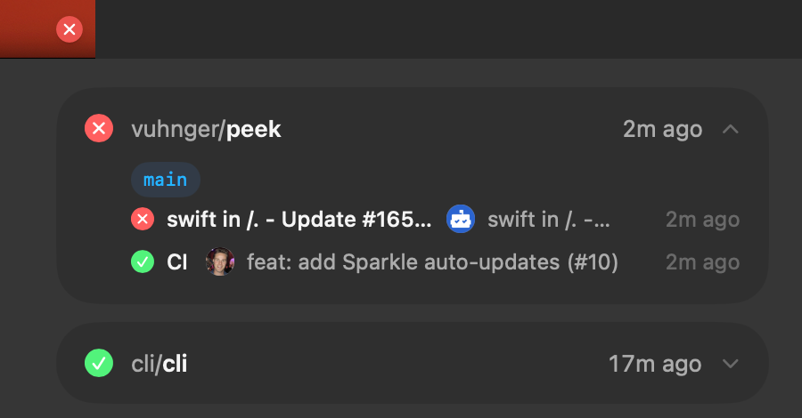

# Cight

GitHub Actions and GitLab pipeline status for your repos, in the menu bar.

Download the latest `.dmg` from [releases](https://github.com/vuhnger/cight/releases/latest) and drag it to Applications.
The first launch says Apple could not verify Cight is free of malware, because the app is not notarized. Click Done, open System Settings, go to Privacy & Security, click Open Anyway next to Cight and confirm.
Run `gh auth login` first. Cight uses your GitHub CLI login.
For GitLab, run `glab auth login`.

GPL-3.0
